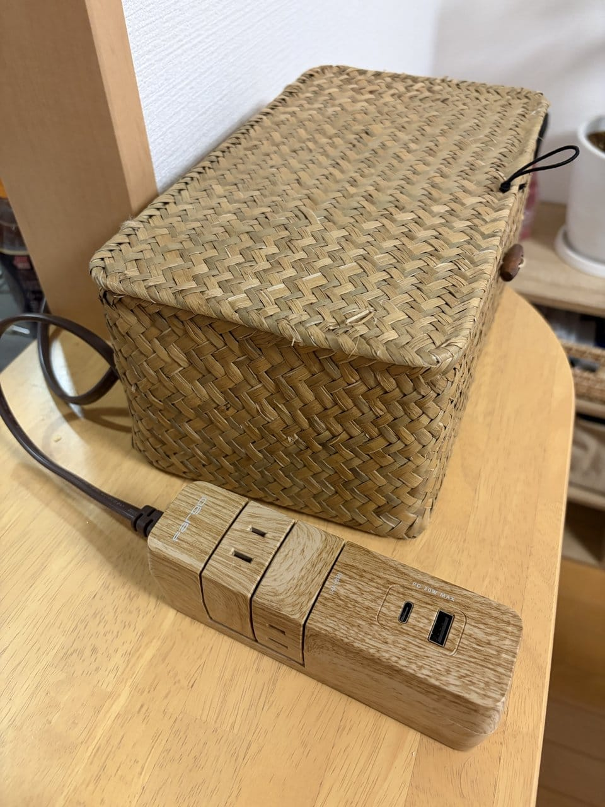
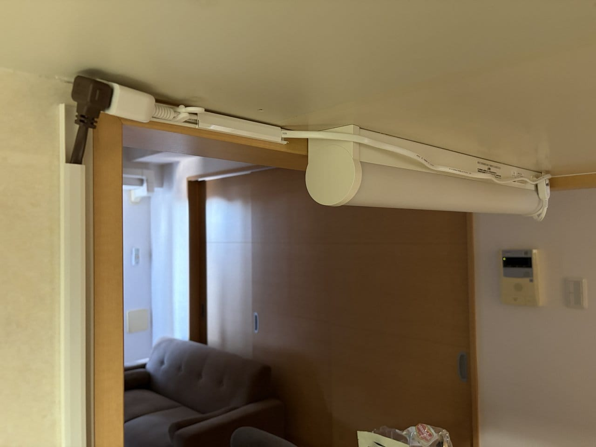
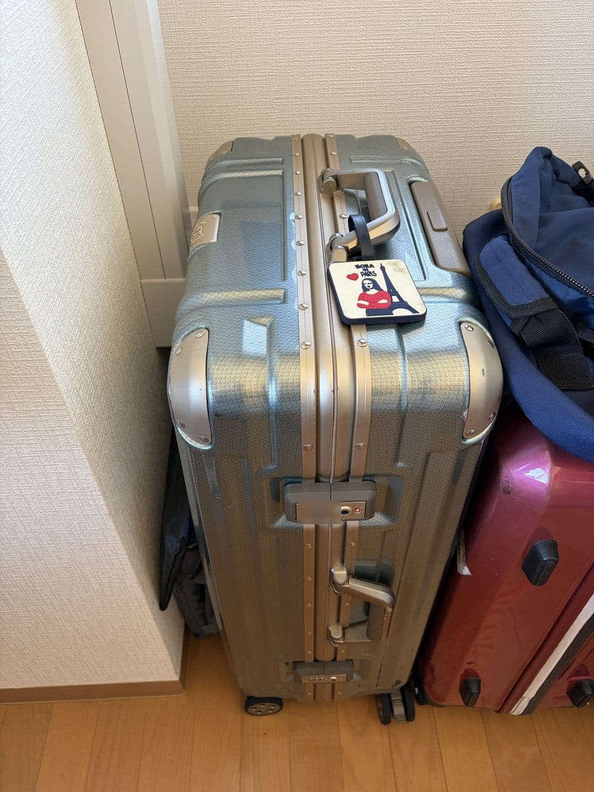
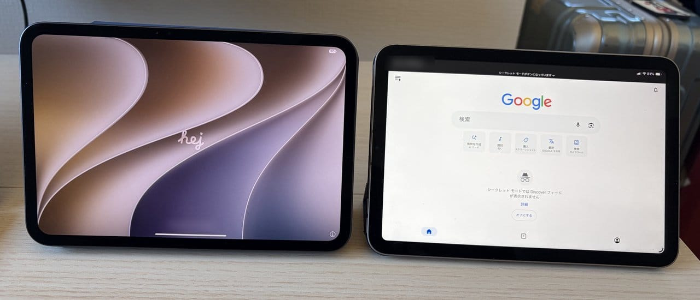
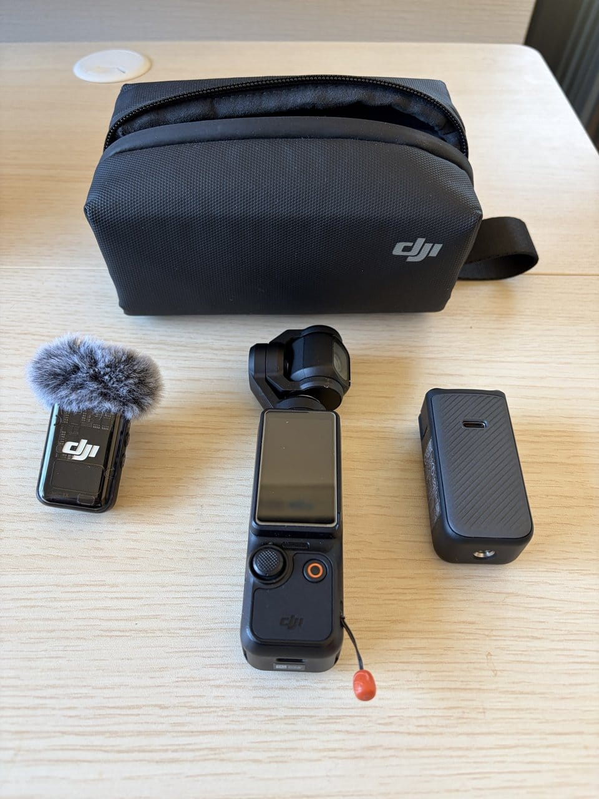

Hello! I'm [@Ryo54388667](https://x.com/Ryo54388667)!☺️

I work as an engineer in Tokyo, and since this year I've been living with my wife!

This time I'm announcing **my top 10 best buys of 2026**!

Back in July I wrote up [my best buys from the first half of 2026](/en/blogs/zakki/best-buy-2026-first-half), but I kept on shopping in the second half too (lol)

If the first half was "six months of furnishing a new home from scratch," the second half was "six months of preparing for our honeymoon and squashing the small annoyances of daily life."

By the way, our honeymoon was in Europe — we spent over two weeks traveling around...! A few of the things we brought along show up later in this list.

This time I put the first half's top 10 and everything from the second half together, and re-ranked them into a top 10 for the whole year, based on one question: "Could I give it up now?" I've kept the first-half items short.

Every item comes with who I'd recommend it to — and who I wouldn't — so just pick out the ones that fit you.

> \*This article contains affiliate links (PR). Everything here was bought with our own money and is still in use today.

\*Prices are what we paid or as of writing (November 2026). They swing a lot with sales, so please check the links for current prices🙏

First, here's the full top 10.

| Rank | What I bought | Rough price | Recommended for |
| --- | --- | --- | --- |
| No. 10 | [Yamaichi soy sauce, sweet (1L)](/en/blogs/zakki/best-buy-2026#h570c72a3c9) | 1,380 yen | Upgrading your sashimi-night soy sauce |
| No. 9 | [by Amazon frozen tonjiru vegetables, 1kg](/en/blogs/zakki/best-buy-2026#h91587204af) | Around 1,400 yen | No energy left for soup on weeknights |
| No. 8 | [Fargo TAPKING T4 power strip](/en/blogs/zakki/best-buy-2026#h6139b67f6e) | Around 4,900 yen | A power strip that stays in plain sight |
| No. 7 | [Hitachi Pawakaru Stick PV-BL50L](/en/blogs/zakki/best-buy-2026#hc64cc0b56b) (1st half No. 8) | Low 30,000s | Grabbing a vacuum the moment you see dust |
| No. 6 | [Toyo Plan slim wagon (12.5cm wide)](/en/blogs/zakki/best-buy-2026#ha23e88b8b6) (1st half No. 3) | 1,880 yen | A gap of about 13cm |
| No. 5 | [WALL TV stand V3](/en/blogs/zakki/best-buy-2026#he66def00b7) (1st half No. 2) | 39,900 yen | A wall-mounted look, no installation |
| No. 4 | [Legend Walker suitcase (L, 83L)](/en/blogs/zakki/best-buy-2026#h26f804c25f) | 20,000s | Overseas trips of a week or more |
| No. 3 | [Apple iPad mini (A20 Pro)](/en/blogs/zakki/best-buy-2026#h8c099ae80f) | From 140,000s | One-handed reading and handwritten notes |
| No. 2 | [Hisense 55-inch 4K TV 55E7N](/en/blogs/zakki/best-buy-2026#hc26740b718) (1st half No. 1) | 80,000s | Watching sports on a big screen |
| No. 1 | [DJI Osmo Pocket 3 (used)](/en/blogs/zakki/best-buy-2026#h0cdabd422c) | 50,000s | Keeping your travels on video |

Alright — starting from No. 10!

## No. 10 to No. 8: Small Upgrades for the Table and the Kitchen

First, three items under 5,000 yen. They're modestly priced, but since we use them every day, they made a real difference.

### No. 10: Yamaichi Soy Sauce, Sweet

This year's best buy that came from the most unexpected place. [Yamaichi Soy Sauce (sweet)](https://item.rakuten.co.jp/kawasakigroup/23016/) from Toyama Prefecture, sold on Rakuten under the name "Uozuya 1925."

We first met when I bought sashimi from a mobile food truck that came to our neighborhood. A little packet of soy sauce came with it as a freebie.

And when I tasted it — honestly, the soy sauce was better than the sashimi (lol)

After that I tracked down the 1L bottle on Rakuten and bought it myself.

We use it for sashimi and chilled tofu. My wife loves it too, so it's now officially "the sashimi-night soy sauce" at our place.

It's 1,380 yen for 1L (free shipping). A bit pricey for soy sauce, but if it makes every pack of sashimi more satisfying, that's cheap.

- Recommended for: people who want a slightly better soy sauce for sashimi or chilled tofu nights, people who like their soy sauce on the sweet side
- Not recommended for: people who like a sharp, salty soy sauce, people looking for an everyday soy sauce to pour freely into stews and stir-fries

The same shop also had a 1.8L bottle and a "Matsu" (umami) version, so switching to those is an option once you're hooked.

### No. 9: by Amazon Frozen Tonjiru Vegetables, 1kg

Amazon's private-label frozen vegetables: [Tonjiru (pork miso soup) mix, 1kg](https://www.amazon.co.jp/dp/B0F19BPX7N). Daikon, taro, carrot, onion, and burdock — all pre-cut and frozen.

As a two-income couple, there are weeknights where we just don't have the energy left to make miso soup...

I love tonjiru. But the moment I picture shaving burdock and peeling taro, my spirit breaks😅

With this, you toss it into the pot frozen, simmer with pork, and stir in miso. That's it.

The root-vegetable prep disappears completely, so tonjiru now shows up on ordinary weeknights. I've reordered it three times in the second half alone.

The catch: it hogs the freezer. Each bag is a flat, wide 35×23×5cm, so you'll need to clear some freezer space before it arrives.

- Recommended for: people with no energy left for soup on weeknights, people who've given up on tonjiru because of the root-vegetable prep
- Not recommended for: people with a small freezer, or a freezer that's already packed

It's around 1,400 yen for 1kg.

<MoshimoAffiliate id="0" />

### No. 8: Fargo TAPKING T4 Power Strip

Fargo's [TAPKING T4 (PD30W, beige wood)](https://www.amazon.co.jp/dp/B0DFB5W8JX) power strip.

It lives in the kitchen. Phone charging and kitchen appliances all run through this one strip.

Each outlet rotates on its own, so even a chunky AC adapter doesn't fight with the outlet next to it. There's also a USB-C port (PD30W), so the phone just needs one cable.

But honestly, the deciding factor was the look.

It's a beige wood-grain finish, and even the cord is brown. Left out on the kitchen counter, it doesn't look like clutter.

From the wall outlet, I ran the cord along the wall inside a cable cover and brought it over to the kitchen. Just not having a bare cord showing makes the whole kitchen look tidier.

That said, the price is bold for a power strip. Around 4,900 yen did make me hesitate before buying (lol)

- Recommended for: people who leave a power strip out in plain sight, like in the kitchen or living room, people who want to plug in bulky AC adapters side by side
- Not recommended for: people who hide their power strip behind furniture (a regular one is plenty for that)

<MoshimoAffiliate id="1" />

## No. 7 to No. 5: Home Staples Still Going Strong Since the First Half

These three are all from the first half. Their ranks moved, but all three are still working hard in our daily life.

### No. 7: Hitachi Pawakaru Stick PV-BL50L

Hitachi's cordless vacuum, the [Pawakaru Stick PV-BL50L](https://kadenfan.hitachi.co.jp/clean/lineup/pv-bl50l/), moved up one spot from No. 8 in the first half.

The reason: even into autumn, still no complaints. Thanks to its 1.4kg weight, our routine of leaving it out in the corner of the living room and grabbing it the moment we notice dust is still going strong.

In the first-half article I wrote about comparing it with the newer PV-BL50P and deliberately picking the previous model. Actually, I used this "buy last year's model" strategy one more time in the second half. You'll see where further up the list.

- Recommended for: people who want to leave the vacuum out and use it the moment they spot dirt, people happy to save money with last year's model
- Not recommended for: people mainly cleaning pet hair or carpets, who put suction power first

The full review is under [No. 8 in my first-half best buys](/en/blogs/zakki/best-buy-2026-first-half#h89ddf04333).

<MoshimoAffiliate id="2" />

### No. 6: Toyo Plan Slim Wagon (12.5cm wide)

A 1,880-yen slim wagon. That narrow, useless gap next to the washing machine finally became storage.

It's still the designated spot for our detergent refills.

It dropped from No. 3 to No. 6, but not because of any complaint about the wagon. The second-half newcomers were just too strong. For 1,880 yen, the value is unbeatable.

- Recommended for: people with a narrow gap in the washroom or kitchen they've given up on (the test is whether a 12.5cm-wide wagon fits)
- Not recommended for: people about to buy without measuring. Being a few millimeters short means it won't fit, so grab a tape measure first

The tips on measuring the gap are under [No. 3 in my first-half best buys](/en/blogs/zakki/best-buy-2026-first-half#h0a625f368c).

<MoshimoAffiliate id="3" />

### No. 5: WALL TV Stand V3

The first half's No. 2, the [WALL V3](https://equals.tokyo/c/wall_tv_stand/v3sw_low). Instead of a TV cabinet, it stands the TV neatly against the wall.

I still love our living room without a TV cabinet. Being able to turn the TV toward wherever we're sitting is as handy as ever.

It dropped in rank because second-half newcomers took No. 4, No. 3, and No. 1.

- Recommended for: people who want to free up the living-room space a TV cabinet takes, people who want a wall-mounted look without any installation work
- Not recommended for: people with lots of recorders and game consoles around the TV (with no shelf, you'll need to find somewhere else for them)

For the full story, including the assembly-and-setup service, see [No. 2 in my first-half best buys](/en/blogs/zakki/best-buy-2026-first-half#h4e908c3c68).

<MoshimoAffiliate id="4" />

## No. 4 to No. 1: The Top Four That Defined My Year

Now for the top four. Three of the four are things I bought in the second half.

### No. 4: Legend Walker Aluminum-Frame Suitcase (L)

First up, a star of the second half.

For our honeymoon I bought a Legend Walker aluminum-frame suitcase (5509-70, size L, 83L). I paid in the 20,000s.

I picked it for the balance between toughness and weight.

We were headed to Europe for over two weeks. With connecting flights, I wanted something that wouldn't break even if checked baggage got handled roughly.

But tough suitcases tend to be heavy. This one is 75.5×51×28cm and 5.6kg — not too heavy for a frame type — and its three dimensions add up to 154.5cm, which fits under the checked-baggage size limit common on international flights (158cm total). Rules vary by airline, so check yours too.

In short, I was aiming for "the biggest size you can check."

The result: totally satisfied.

- The casters rolled smoothly through airports and stations, so pulling it wasn't tiring
- It held a lot of stuff for over two weeks, which was a big help
- It got checked many times and never broke, with barely any scratches

When something breaks mid-trip, that alone can wreck the day's plans. Not having to worry about the suitcase once in two weeks was the biggest win.

If I had to name one weakness: it takes up space when open. Unlike zipper types, you can't just crack the lid a little — a frame suitcase splits wide open into two halves. In small hotel rooms, I found myself hunting for space to lay it out😅

- Recommended for: people going on overseas trips of a week or more, people who want something sturdy enough to survive rough baggage handling
- Not recommended for: people who want to keep the suitcase open in a cramped hotel room (you need floor space for it to open fully)

By the way, this model also comes with caster stoppers, a USB port, and a phone holder.

<MoshimoAffiliate id="5" />

### No. 3: Apple iPad mini (A20 Pro)

The 2026 [iPad mini (A20 Pro)](https://www.apple.com/jp/ipad-mini/). I upgraded from the previous iPad mini (A17 Pro) and bought it at full price from Apple.

I decided pretty much instantly (lol)

What sold me: it's thinner than the previous model, and the bezels are slimmer. It's 5.4mm thick, and the display is now an 8.5-inch OLED. Same one-hand size, just more screen.

I use it for reading books and manga, taking study notes, and working on the go. I handwrite notes with the Apple Pencil Pro.

I went with the cellular model (512GB) so I don't have to tether when I'm out. Having it already online the moment I take it out of my bag is more comfortable than I expected. I can't go back to turning on my phone's hotspot every time.

To be honest, I've only had it for about two weeks. Still, the thinness and the extra screen are differences you notice the moment you pick it up, so it gets No. 3 for the year.

Price-wise, even the cheapest cellular model (128GB) starts in the 140,000-yen range (ours is 512GB, so it's even more😅).

- Recommended for: people who read a lot of e-books or manga, people who want to take handwritten notes with an Apple Pencil, people who want a tablet you can hold in one hand
- Not recommended for: people mainly doing video or illustration who want a big screen (an iPad Air would probably suit you better)

<MoshimoAffiliate id="6" />

### No. 2: Hisense 55-inch 4K LCD TV 55E7N

The first half's No. 1, the Hisense 55-inch 4K TV 55E7N.

It's still the star of our weekend sports viewing. Considering I got it in the 80,000s on sale, my satisfaction is near the top of the year.

It handed the No. 1 spot to the camera coming up next.

- Recommended for: people who want to watch weekend sports on a big screen, people who want a 55-inch TV once its price has dropped well below launch
- Not recommended for: people who care about sound but don't want to add a soundbar

Why I chose a model with a high-refresh panel for sports, and my take on its thin-sounding speakers, are under [No. 1 in my first-half best buys](/en/blogs/zakki/best-buy-2026-first-half#h3a40588a16).

<MoshimoAffiliate id="7" />

### No. 1: DJI Osmo Pocket 3 🎉

My No. 1 for 2026 is DJI's gimbal camera, the [Osmo Pocket 3](https://www.dji.com/jp/osmo-pocket-3)!

I bought it used, in the 50,000-yen range, to capture our honeymoon on video.

I went used because the successor, the Osmo Pocket 4, had come out and the Pocket 3 had gotten cheaper as last year's model. As of November, the Pocket 4 Essential Combo was 77,660 yen on Amazon, so I got this for a lot less. This is round two of the "buy last year's model" strategy I mentioned at No. 7 (lol)

Bringing the Osmo instead of relying on my phone was the right call.

What mattered most: no shake even when filming while walking. The 3-axis gimbal holds the camera steady, so even footage shot while strolling through European streets doesn't make you seasick on rewatch.

I also liked how short the gap is between "oh, I want to film this view" and actually recording. Just flip the screen around and it powers on.

And a surprisingly big help: it doesn't eat my phone's storage or battery. On a trip, the phone is busy with maps and translation, so I left all the video to the Osmo.

Footage is saved to a microSD card. 4K video fills storage fast, so I'd say buying a microSD card (ours is 256GB) at the same time is a must.

I bought some accessories too, but in the end the only essential one was the microSD card.

Appliances get replaced someday, but honeymoon footage can't be reshot... Getting to bring that home for something in the 50,000s — **nothing else could be my top purchase of the year.**

- Recommended for: people who want to keep travel memories on video, people who want to save their phone's battery and storage while traveling, people who don't need the latest model
- Not recommended for: people mainly after beautiful still photos (this is a camera built around video)

If you're buying used, check battery life and whether the accessories are all there before you buy. The Pocket 3 is still sold new as well, so compare prices before deciding.

<MoshimoAffiliate id="8" />

## Two That Just Missed the Cut

They didn't make the top 10, but let me introduce two more things I'm glad I bought.

### Telic Recovery Sandal W-FLIPFLOP

Telic's thick-soled recovery sandal, the [W-FLIPFLOP](https://www.amazon.co.jp/dp/B0873K6SQ9). I bought it after seeing good reviews on social media.

I wear them for trips around the neighborhood. Thanks to the thick soles, my feet don't get tired even after walking in them for a long time, despite them being sandals — that's the best part.

That said, they cost around 5,000 yen. Also, for the first few days, until the thong strap broke in, it hurt between my toes.

- Recommended for: people who want sandals that keep their feet from getting tired, even on quick trips out
- Not recommended for: people who won't pay 5,000 yen for sandals, people who don't like thong-style straps

<MoshimoAffiliate id="9" />

### Owltech Retractable Cable That Extends From One Side

Owltech's [retractable cable that extends from one side only (USB-A to USB-C, 120cm)](https://www.amazon.co.jp/dp/B0H33MK221). A small item I brought on our honeymoon.

Since only one side extends, you can pull out just the length you need.

And one thing I noticed while traveling: charging ports on planes and on the road are still surprisingly often USB-A. USB-C ports weren't that common, so having this USB-A to USB-C cable in my bag really helped.

- Recommended for: people who want one compact charging cable for overseas trips or business travel, people who'll be charging from USB-A ports like the ones on plane seats
- Not recommended for: people whose chargers and phone are all USB-C and who don't expect to use USB-A ports

<MoshimoAffiliate id="10" />

## Wrapping Up

That was my top 10 best buys of 2026!

You probably don't need all of them, so here's where I'd start, depending on what you're after.

- If you have a trip coming up: [the Osmo Pocket 3 at No. 1](/en/blogs/zakki/best-buy-2026#h0cdabd422c) and [the suitcase at No. 4](/en/blogs/zakki/best-buy-2026#h26f804c25f)
- If you want to make time at home better: [the 55E7N at No. 2](/en/blogs/zakki/best-buy-2026#hc26740b718) and [the WALL stand at No. 5](/en/blogs/zakki/best-buy-2026#he66def00b7)
- If you want to try something for a few thousand yen: [the tonjiru vegetables at No. 9](/en/blogs/zakki/best-buy-2026#h91587204af) and [the soy sauce at No. 10](/en/blogs/zakki/best-buy-2026#h570c72a3c9)

Looking at it this way, the first half was "shopping to build a home," and the second half was "shopping for travel and for fixing small daily annoyances."

The six first-half items that didn't make this year's ranking (the LOWYA sofa and dining set, the RASIK kitchen board, the ekans laundry rack, [the Yamazaki range hood spice rack](/en/blogs/life_hack/yamazaki-jitsugyo-best-buy), and the Nitori tension shelf) are all still in use today. If you're curious, take a look at [my best buys from the first half of 2026](/en/blogs/zakki/best-buy-2026-first-half).

I've written up the total cost of setting up our new home and the furniture-assembly service I hired in [my roundup of things worth buying and services worth hiring when moving](/en/blogs/life_hack/hikkoshi-best-buy).

I'm looking forward to seeing what I end up buying next year. I'll write again in a year!

Thank you for reading all the way to the end!

I tweet casually, so feel free to follow me!🥺
