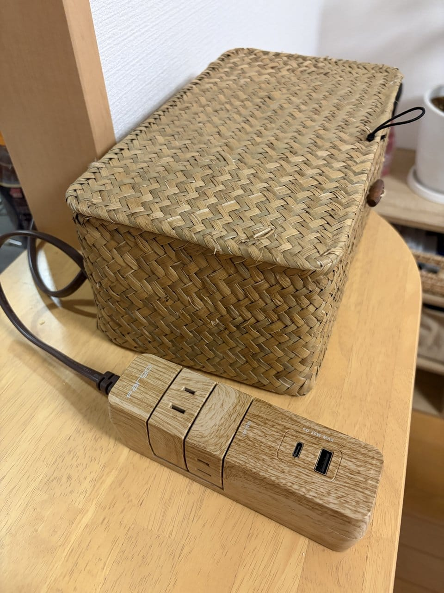
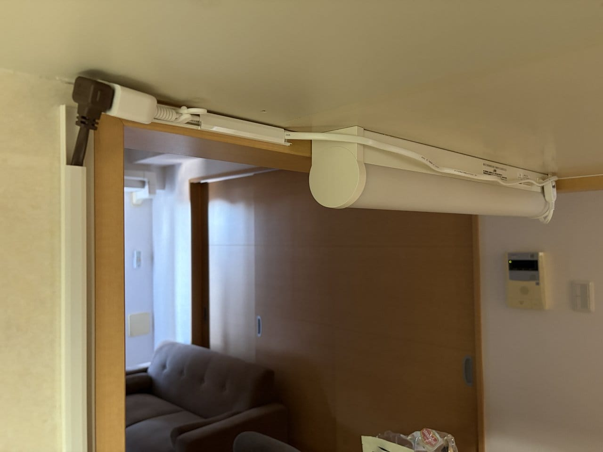
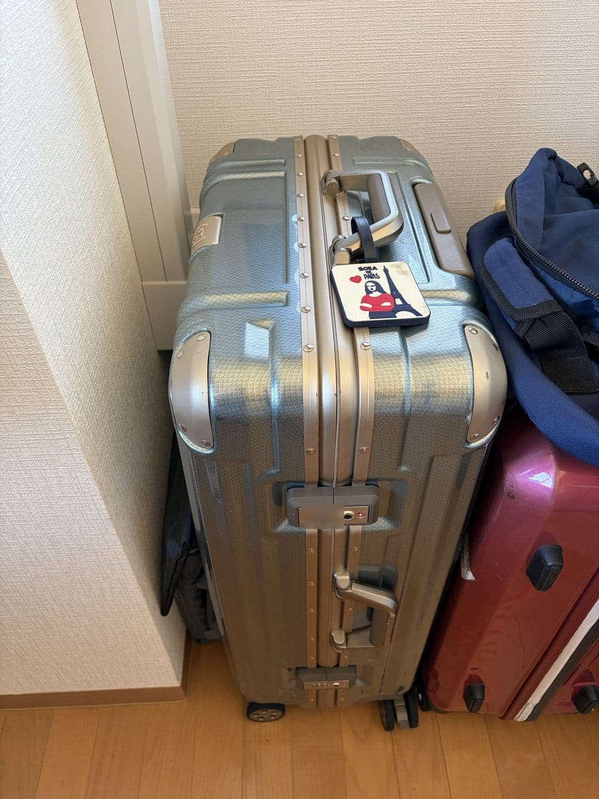
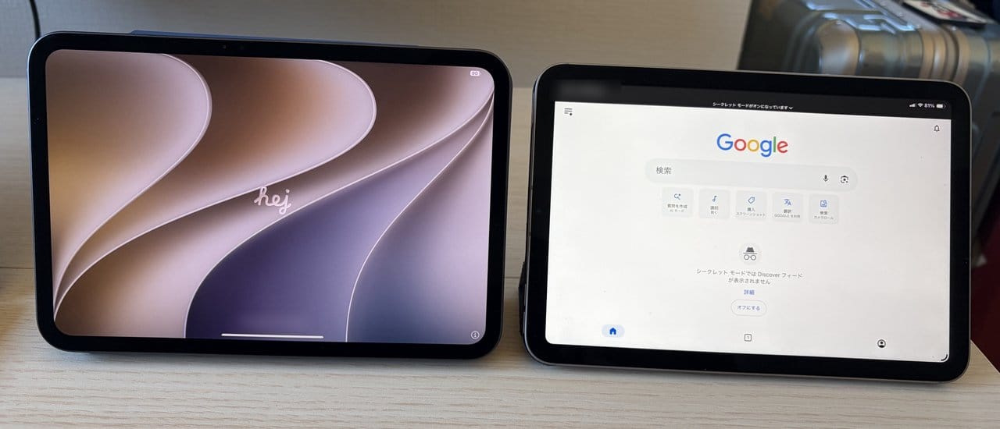
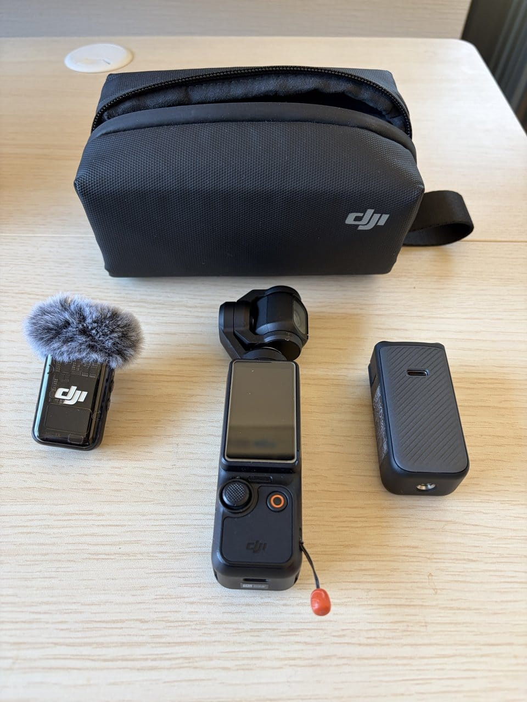

こんにちは！[@Ryo54388667](https://x.com/Ryo54388667)です！☺️

都内でエンジニアをしながら、今年から妻と二人で暮らしています！

今回は **2026年の年間ベストバイ トップ10** を発表していきます！

7月に[2026年上半期のベストバイ](/ja/blogs/zakki/best-buy-2026-first-half)を書いたのですが、下半期も懲りずにいろいろ買いました笑

上半期が「新居の家具と家電をゼロから揃える半年」だったとすると、下半期は「新婚旅行の準備と、暮らしの小さな不満をつぶしていく半年」でした。

ちなみに新婚旅行はヨーロッパで、2週間以上かけて回ってきました。。！その旅に連れて行ったものも、このあと何品か出てきます。

今回は上半期の10品と下半期に買ったものを全部まとめて、「今も手放せないか」を基準に年間のトップ10を決め直しました。上半期組は振り返りを短めにしています。

どの品にも「おすすめする人・しない人」を書いたので、自分に合うものだけ拾っていってください。

> ※この記事にはアフィリエイト広告(PR)が含まれています。載せているのは、どれも自分のお金で買って、いまも実際に使っているものだけです。

※価格は購入時か執筆時点(2026年11月)の目安です。セールで大きく動くので、最新の価格はリンク先で見てください🙏

まずは年間トップ10の一覧です。

| 順位 | 買ったもの | 価格の目安 | おすすめする人 |
| --- | --- | --- | --- |
| 10位 | [ヤマイチ醤油 甘口(1L)](/ja/blogs/zakki/best-buy-2026#h989f91d94a) | 1,380円 | 刺身の日の醤油を格上げしたい人 |
| 9位 | [by Amazon 冷凍 豚汁の具 1kg](/ja/blogs/zakki/best-buy-2026#h62fb89fe9b) | 1,400円前後 | 平日の夜に汁物を作る余力がない人 |
| 8位 | [Fargo 電源タップ TAPKING T4](/ja/blogs/zakki/best-buy-2026#h3b4603febc) | 4,900円前後 | 人目につく場所にタップを置く人 |
| 7位 | [日立 パワかるスティック PV-BL50L](/ja/blogs/zakki/best-buy-2026#hf35764501d)(上半期8位) | 3万円台前半 | 掃除機をサッと出して使いたい人 |
| 6位 | [東洋プラン スリムワゴン(幅12.5cm)](/ja/blogs/zakki/best-buy-2026#hc056ad38c6)(上半期3位) | 1,880円 | 13cm前後の隙間がある人 |
| 5位 | [WALL 壁寄せテレビスタンド V3](/ja/blogs/zakki/best-buy-2026#hf98ff6a85d)(上半期2位) | 39,900円 | 工事なしで壁掛け風にしたい人 |
| 4位 | [レジェンドウォーカー スーツケース(L・83L)](/ja/blogs/zakki/best-buy-2026#h1dce44cbce) | 2万円台 | 1週間以上の海外旅行に行く人 |
| 3位 | [Apple iPad mini(A20 Pro)](/ja/blogs/zakki/best-buy-2026#h360d7c7bd2) | 14万円台〜 | 片手で読書や手書きメモをしたい人 |
| 2位 | [ハイセンス 55V型 4Kテレビ 55E7N](/ja/blogs/zakki/best-buy-2026#h0268a5d7ce)(上半期1位) | 8万円台 | スポーツを大画面で見たい人 |
| 1位 | [DJI Osmo Pocket 3(中古)](/ja/blogs/zakki/best-buy-2026#hef42baad4b) | 5万円台 | 旅行を動画で残したい人 |

それでは10位から！

## 10位〜8位: 食卓とキッチンがちょっと良くなったもの

まずは5,000円以下の3品です。値段は控えめでも、毎日使うものなので効き目はしっかりありました。

### 10位: ヤマイチ醤油 甘口

今年いちばん意外なところからやってきたベストバイです。楽天では「魚津屋1925」の名前で売られている、富山県の[ヤマイチ醤油 甘口](https://item.rakuten.co.jp/kawasakigroup/23016/)。

出会いは、近所に来ていた移動販売でお刺身を買ったときでした。小袋の醤油がおまけでついてきたんです。

で、食べてみたら、正直お刺身より醤油のほうがおいしかった笑

そのあと楽天で1Lボトルを探して、自分で買い直しました。

使い道は刺身と冷奴です。妻にも好評で、うちの「刺身の日の醤油」はこれで決まりました。

価格は1Lで1,380円(送料無料)。醤油にしては少し値が張りますが、刺身1パックの満足度が上がると思えば安いものです。

- おすすめする人: 刺身や冷奴の日に、いつもの醤油を少しいいものにしたい人。甘めの醤油が好きな人
- おすすめしない人: キリッとした辛口が好きな人。煮物や炒め物にどんどん使う、普段使いの醤油を探している人

同じショップに1.8Lボトルや「松」(旨口)もあったので、気に入ったらそっちに乗り換えるのもアリだと思います。

### 9位: by Amazon 冷凍 豚汁の具 1kg

Amazonのプライベートブランドの冷凍野菜、[豚汁の具 1kg](https://www.amazon.co.jp/dp/B0F19BPX7N)です。だいこん・さといも・にんじん・たまねぎ・ごぼうが、切られた状態で凍っています。

共働きの平日の夜って、味噌汁を作る気力が残っていない日があるんですよね。。

豚汁は好きなんです。でも、ごぼうのささがきと里芋の皮むきが頭に浮かんだ時点で心が折れます😅

これは凍ったまま鍋に入れて、豚肉と煮て味噌を溶くだけ。

根菜の下ごしらえがまるごと消えるので、平日の夜でも普通に豚汁が出てくるようになりました。下半期だけで3回リピートしています。

難点は、冷凍庫を占領すること。1袋が35×23×5cmと平たく大きいので、買う前に冷凍庫に場所を空けておく必要があります。

- おすすめする人: 平日の夜に汁物を作る余力がない人、根菜の下ごしらえが面倒で豚汁を諦めている人
- おすすめしない人: 冷凍庫が小さい人、冷凍庫がすでにパンパンの人

価格は1kgで1,400円前後です。

<MoshimoAffiliate id="0" />

### 8位: Fargo 電源タップ TAPKING T4

Fargoの電源タップ[TAPKING T4(PD30W・ベージュウッド)](https://www.amazon.co.jp/dp/B0DFB5W8JX)です。

置き場所はキッチン。スマホの充電と、キッチン家電の電源をこれ1台にまとめています。

差込口が1つずつ回転するので、ACアダプターみたいなゴツいプラグを挿しても隣の口とケンカしません。USB-C(PD30W)もついているので、スマホはケーブルを1本挿すだけです。

ただ、いちばんの決め手は見た目でした。

木目調のベージュウッドで、コードまでブラウン。キッチンに出しっぱなしでも生活感が出ません。

コンセントからは配線カバーで壁沿いにコードを這わせて、キッチンの近くまで引っ張ってきています。コードがむき出しにならないだけで、キッチン全体が片付いて見えるようになりました。

ただ、値段は電源タップにしては強気です。4,900円前後は、さすがに買う前にためらいました笑

- おすすめする人: キッチンやリビングなど、人の目に入る場所にタップを出しっぱなしにする人。ACアダプターのような大きいプラグを並べて挿したい人
- おすすめしない人: 家具の裏に隠して使う人(それなら普通のタップで十分です)

<MoshimoAffiliate id="1" />

## 7位〜5位: 上半期から使い続けている家の定番

ここからの3品は上半期組です。順位は動きましたが、3つとも今も毎日の暮らしで働いています。

### 7位: 日立 パワかるスティック PV-BL50L

日立のコードレス掃除機[パワかるスティック PV-BL50L](https://kadenfan.hitachi.co.jp/clean/lineup/pv-bl50l/)は、上半期8位から1つ順位を上げました。

秋になっても不満が出てこない、というのが上げた理由です。1.4kgの軽さのおかげで、リビングの隅に出しっぱなしにして気づいたらサッと掛ける運用が、いまも続いています。

上半期の記事では、最新モデルのPV-BL50Pとの差分を調べて、あえて型落ちを選んだ話を書きました。実はこの「型落ち作戦」、下半期にもう1回使っています。どこで使ったかは、上位のほうで出てきます。

- おすすめする人: 掃除機を出しっぱなしにして、汚れに気づいたらすぐ掛けたい人。最新機能にこだわらず、型落ちで安く買いたい人
- おすすめしない人: ペットの毛やカーペットの掃除がメインで、吸引力をいちばんに考えたい人

詳しいレビューは[上半期ベストバイの8位](/ja/blogs/zakki/best-buy-2026-first-half#h89ddf04333)に書いています。

<MoshimoAffiliate id="2" />

### 6位: 東洋プラン スリムワゴン(幅12.5cm)

1,880円のスリムワゴンです。洗濯機の横の、使い道がなかった細い隙間がこれで収納になりました。

いまも洗剤の詰め替えストックの定位置として働いてくれています。

上半期3位から6位に下がりましたが、ワゴンに不満が出たわけではありません。下半期の新顔が強すぎただけです。1,880円でこの働きぶりなら、コスパの面では文句なしです。

- おすすめする人: 洗面所やキッチンに、物を置くのを諦めた細い隙間がある人(幅12.5cmのワゴンが入るかが目安です)
- おすすめしない人: 隙間を測らずに買おうとしている人。数mm足りないだけで入らないので、メジャーで測ってからにしてください

隙間の採寸の話は[上半期ベストバイの3位](/ja/blogs/zakki/best-buy-2026-first-half#h0a625f368c)にまとめています。

<MoshimoAffiliate id="3" />

### 5位: WALL 壁寄せテレビスタンド V3

上半期2位の[WALL V3](https://equals.tokyo/c/wall_tv_stand/v3sw_low)です。テレビ台の代わりに、テレビを壁際にスッと立たせるスタンドです。

テレビ台が消えたリビングは、いまも気に入ったままです。座る場所に合わせてテレビの向きを変えられるのも、相変わらず重宝しています。

順位を下げたのは、このあと4位・3位・1位に下半期の新顔が入ってきたからです。

- おすすめする人: テレビ台のぶんだけでもリビングを広く使いたい人。工事なしで、壁掛けのような見た目にしたい人
- おすすめしない人: テレビまわりにレコーダーやゲーム機をたくさん置く人(棚がないぶん、置き場所は別に考える必要があります)

組立設置サービスの話も含めて、詳しくは[上半期ベストバイの2位](/ja/blogs/zakki/best-buy-2026-first-half#h4e908c3c68)に書いています。

<MoshimoAffiliate id="4" />

## 4位〜1位: 今年の主役になったトップ4

ここから上位4品です。4つのうち3つは、下半期に買ったものです。

### 4位: レジェンドウォーカー アルミフレーム スーツケース(Lサイズ)

まずは下半期の主役から。

新婚旅行のために買った、レジェンドウォーカーのアルミフレーム スーツケース(5509-70・Lサイズ・83L)。2万円台で買いました。

選んだ理由は、頑丈さと重さのバランスです。

行き先はヨーロッパで、期間は2週間以上。飛行機の乗り継ぎもあるので、預け荷物で雑に扱われても壊れない頑丈さが欲しかったんです。

かといって、頑丈なスーツケースは重いものが多い。これは75.5×51×28cmで5.6kg。フレームタイプにしては重すぎず、3辺の合計は154.5cmで、国際線でよくある受託手荷物のサイズ上限(3辺158cm以内)に収まります。規定は航空会社ごとに違うので、乗る便でも確認してみてください。

要するに、「預けられる中でいちばん大きいサイズ」を狙って選びました。

結果は大満足です。

- 空港や駅の移動でキャスターがスムーズで、引いていて疲れなかった
- 2週間分の荷物がたくさん入って助かった
- 何回も預けたのに壊れず、傷も少なかった

旅行中に何かが壊れると、それだけでその日の予定が崩れます。2週間、スーツケースのことを一度も心配しなくてよかったのが、いちばんの収穫でした。

弱点をひとつ挙げるなら、開けるときに場所を取ることです。フレーム式はファスナー式と違ってフタだけ少し開けることができず、左右にガバッと全開きになります。ホテルの部屋が狭いと、広げる場所を探すことになりました😅

- おすすめする人: 1週間以上の海外旅行に行く人。預け荷物で雑に扱われても壊れない頑丈さが欲しい人
- おすすめしない人: ホテルの狭い部屋で、スーツケースを開いたまま過ごしたい人(全開きのスペースが必要です)

ちなみにこのモデルには、キャスターのストッパーやUSBポート、スマホホルダーもついています。

<MoshimoAffiliate id="5" />

### 3位: Apple iPad mini(A20 Pro)

2026年モデルの[iPad mini(A20 Pro)](https://www.apple.com/jp/ipad-mini/)です。前のiPad mini(A17 Pro)からの買い替えで、Apple公式で定価で買いました。

ほぼ迷わずに即決です笑

決め手は、前モデルより薄くなって、画面のベゼルも細くなったこと。厚さは5.4mmで、ディスプレイは8.5インチの有機EL(OLED)になりました。同じ片手サイズのまま、画面だけ広くなった感覚です。

用途は、読書と漫画、勉強のメモ、それから外出先での作業。メモはApple Pencil Proで手書きしています。

セルラーモデル(512GB)にしたのは、外出先でテザリングをしなくて済むからです。カバンから出して開いた瞬間にネットにつながっているのは、思った以上に快適でした。スマホのテザリングをいちいちオンにしていた頃にはもう戻れません。

正直に言うと、買ってからまだ2週間ほどです。それでも、薄さと画面の広さは手に取った瞬間にわかる差だったので、年間3位に置きました。

価格は、いちばん安い128GBのセルラーモデルでも14万円台からです(うちは512GBなので、さらに上です😅)。

- おすすめする人: 電子書籍や漫画を読むことが多い人、Apple Pencilで手書きのメモを取りたい人、片手で持てるタブレットが欲しい人
- おすすめしない人: 動画やイラスト制作がメインで、大きい画面が欲しい人(それならiPad Airのほうが合うと思います)

<MoshimoAffiliate id="6" />

### 2位: ハイセンス 55V型 4K液晶テレビ 55E7N

上半期の1位だった、ハイセンスの55V型4Kテレビ55E7Nです。

休日のスポーツ観戦はいまもこのテレビが主役です。セールで8万円台で買えたことを考えると、満足度は年間でもトップクラスです。

1位を譲った相手は、このあと出てくるカメラです。

- おすすめする人: 週末のスポーツ中継を大画面で見たい人。発売時より大きく値下がりしたタイミングで、55V型を手に入れたい人
- おすすめしない人: テレビの音にもこだわりたいけれど、サウンドバーは足したくない人

スポーツ向けに倍速パネルのモデルを選んだ理由や、音の物足りなさの話は[上半期ベストバイの1位](/ja/blogs/zakki/best-buy-2026-first-half#h3a40588a16)に書いています。

<MoshimoAffiliate id="7" />

### 1位: DJI Osmo Pocket 3 🎉

2026年の年間1位は、DJIのジンバルカメラ[Osmo Pocket 3](https://www.dji.com/jp/osmo-pocket-3)です！

新婚旅行を動画で残すために、中古で5万円台で買いました。

中古にしたのは、後継のOsmo Pocket 4が出て、型落ちになった3が安くなっていたからです。11月時点のAmazonだと、Pocket 4のエッセンシャルコンボは77,660円でした。それと比べると、ずいぶん安く手に入りました。7位のパワかるで書いた「型落ち作戦」の2回目がこれです笑

スマホではなくOsmoを持っていって正解でした。

いちばん効いたのは、歩き撮りでもブレないこと。3軸のジンバルがカメラを支えてくれるので、ヨーロッパの街を歩きながら撮っても、あとで見返して酔うような映像になりません。

「あ、今の景色撮りたい」と思ってから撮り始めるまでが早いのもよかったです。画面をくるっと回せば電源が入ります。

あと意外と助かったのが、スマホの容量と電池を食わないこと。旅行中のスマホは地図と翻訳で大忙しなので、動画は全部Osmoに任せていました。

撮った動画はmicroSDに保存されます。4K動画はすぐに容量を食うので、microSD(うちは256GB)は一緒に買うのが必須だと思います。

一緒に買ったアクセサリーもありますが、結局、必須だったのはmicroSDだけでした。

家電はいつか買い替えるけど、新婚旅行の映像はもう撮り直せないんですよね。。それを5万円台で持ち帰れたと思うと、**今年いちばんの買い物はこれ以外ありませんでした。**

- おすすめする人: 旅行の思い出を動画で残したい人、スマホの電池とストレージを旅行中に温存したい人、最新モデルにこだわらない人
- おすすめしない人: 写真(静止画)をきれいに撮るのがメインの人(動画が主役のカメラです)

中古で狙うなら、バッテリーの持ちや付属品がそろっているかを確認してから買うのが安心です。新品のPocket 3もまだ売られているので、値段を比べてから決めてみてください。

<MoshimoAffiliate id="8" />

## 惜しくもランク外の2品

トップ10には入らなかったけれど、買ってよかったものを2つだけ紹介させてください。

### テリック リカバリーサンダル W-FLIPFLOP

テリックの厚底リカバリーサンダル[W-FLIPFLOP](https://www.amazon.co.jp/dp/B0873K6SQ9)です。SNSや口コミで評判を見て買いました。

近所に出かけるとき用に履いています。靴底が厚いぶん、サンダルなのに長い時間歩いても足が疲れにくいのがいちばんの良さです。

ただ、値段は5,000円前後します。それと、鼻緒が足になじむまでの数日は指の間が痛かったです。

- おすすめする人: ちょっとした外出でも、足が疲れにくいサンダルを履きたい人
- おすすめしない人: サンダルに5,000円は出せない人、鼻緒タイプが苦手な人

<MoshimoAffiliate id="9" />

### オウルテック 片方だけ引き出せる巻取りケーブル

オウルテックの[片方だけ引き出せる巻取りケーブル(USB-A to USB-C・120cm)](https://www.amazon.co.jp/dp/B0H33MK221)。新婚旅行に持っていった小物です。

片側だけ伸びるので、必要な長さだけ引き出して使えます。

そして旅をしてみて気づいたのが、飛行機や旅先の充電口は、意外とまだUSB-Aが多いということ。USB-Cの口はそこまで一般的ではなかったので、USB-AからUSB-Cにつなぐこのケーブルを1本入れておいて助かりました。

- おすすめする人: 海外旅行や出張に、かさばらない充電ケーブルを1本持っていきたい人。飛行機の座席などUSB-Aの口から充電する機会がある人
- おすすめしない人: 充電器もスマホもUSB-Cでそろえていて、USB-Aの口を使う予定がない人

<MoshimoAffiliate id="10" />

## 最後に

2026年の年間ベストバイ トップ10でした！

全部は要らないと思うので、目的別に「まずはこれ」を挙げておきます。

- 旅行の予定がある人: [1位のOsmo Pocket 3](/ja/blogs/zakki/best-buy-2026#hef42baad4b)と[4位のスーツケース](/ja/blogs/zakki/best-buy-2026#h1dce44cbce)
- 家で過ごす時間を良くしたい人: [2位の55E7N](/ja/blogs/zakki/best-buy-2026#h0268a5d7ce)と[5位のWALL](/ja/blogs/zakki/best-buy-2026#hf98ff6a85d)
- まずは数千円で試したい人: [9位の豚汁の具](/ja/blogs/zakki/best-buy-2026#h62fb89fe9b)と[10位の醤油](/ja/blogs/zakki/best-buy-2026#h989f91d94a)

こうして並べると、上半期は「家を作る買い物」、下半期は「旅と毎日の小さな不満を解決する買い物」だったなと思います。

上半期のトップ10から今回の年間ランキングに残れなかった6品(LOWYAのソファとダイニングセット、RASIKのキッチンボード、ekansのランドリーラック、[山崎実業のレンジフード調味料ラック](/ja/blogs/life_hack/yamazaki-jitsugyo-best-buy)、ニトリのつっぱり棚)も、いまも全部現役で働いています。気になる方は[2026年上半期のベストバイ](/ja/blogs/zakki/best-buy-2026-first-half)のほうを見てみてください。

新居を揃えたときの総額や、くらしのマーケットの組み立て代行の話は[引っ越しで買ってよかったもの&頼んでよかったサービスのまとめ](/ja/blogs/life_hack/hikkoshi-best-buy)に書いています。

来年はどんな買い物をするのか、自分でも楽しみです。また1年後に書きます！

最後まで読んでいただきありがとうございます！

気ままにつぶやいているので、気軽にフォローをお願いします！🥺
