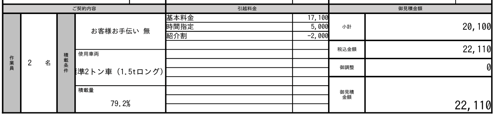

こんにちは！[@Ryo54388667](https://x.com/Ryo54388667)です！☺️

都内でエンジニアとして働いています！

2026年4月、都内の近距離引越しをケーエー引越センターにお願いしました。

今回は **ケーエー引越センターに実際に頼んでみた口コミ・評判** を、見積もりメールと見積書の明細をもとに書いていきます！

「ケーエー 口コミ」で調べると、比較サイトの星の数はたくさん出てきます。ただ、実際にいくら払ったのか、見積もりがどう変わったのかまで書いてある体験談は見つからなかったんですよね。。

なので、自分で全部出すことにしました。

> ※この記事には、ケーエー引越センターのアフィリエイト広告(PR)を含みます。料金はすべて自分で払った実費です。

## 依頼した引越しの条件

前提をそろえておきます。

- 時期: 2026年4月22日(水)。新生活シーズンど真ん中の平日
- 距離: 都内の区をまたぐ近距離
- 間取り: 1K → 2LDK
- 建物: 旧居はエレベーターなし、新居はエレベーターあり
- 荷物: ドラム式洗濯機、デスクチェア、32インチの液晶モニター、ダンボール20個

家具はほぼ新居で買い直したので、運んでもらったのはこれだけです。

## 結論、税込22,110円で「また頼みたい」と思えた

いきなり結論ですが、最終的な支払いは **税込22,110円** でした。繁忙期の4月にしては、安く収まったと思います。

当日の作業も丁寧で、総合的には「次に引っ越すときもケーエーに頼む」というのが正直な感想です。

一方で、現金払いのみ・ダンボール有料・最初の概算額があてにならない、といったクセもあります。このあたりは後半でくわしく書きます。

見積書の料金欄はこれです(氏名や住所の部分は切り取っています)。

| 項目 | 金額(税別) |
| --- | --- |
| 基本料金(標準2トン車・作業員2名) | 17,100円 |
| 時間指定(2便: 10〜12時開始) | 5,000円 |
| 紹介割 | -2,000円 |
| 小計 | 20,100円 |
| 税込 | 22,110円 |

紹介割は、以前ケーエーを使ったことのある知人の紹介を電話で伝えたら付けてもらえました。公式サイトにも紹介割の案内があるので、まわりに利用者がいたら聞いてみる価値はあります。

メールでの見積もり依頼は24時間受け付けていて、返事もメールで届きます。電話が苦手な人でも始めやすいです。

[単身引越しに特化した大人気の安心サービス！【ケーエー引越センター】](https://px.a8.net/svt/ejp?a8mat=4BA7X6+CQFSKY+5UYQ+5YJRM)

## ケーエー引越センターの見積もりから予約までの流れ

ケーエーは訪問見積もりをしない業者です。営業さんが家に来ることは一度もなく、メールと電話だけで完結しました。

実際のやり取りを時系列で並べるとこうなります。

| 日時 | できごと |
| --- | --- |
| 3/27(金) 13:51 | 最初の概算見積もりメール。「軽 A」プランで11,600円 |
| 3/27(金) 14:10 | ケーエーから電話(出られず)。詳細を聞きたいというメールが届く |
| 3/27(金) 14:11 | メールの記入フォームに荷物リストと希望日を書いて返信 |
| 3/27(金) 16:09 | 正式な見積もりメール。標準2トン車で22,100円(税別)＋見積書PDF |
| 3/28(土)・3/29(日) | 同じ見積もり額の案内メールが1通ずつ届く |
| 3/29(日) | 電話で予約。紹介割が付いて、契約内容の確認メールが届く |
| 4/18(土) | 当日の注意事項メール(現金の用意・梱包など) |
| 4/20(月) | 作業開始の時間枠「10:00〜12:00」の連絡 |
| 4/22(水) | 引越し当日 |

最初の連絡から予約まで3日でした。電話を使ったのは予約のときくらいで、ほとんどのやり取りはメールで済みました。

### 概算11,600円が倍になった理由

最初のメールを見たときは「1万円ちょっとで引越しできるの！？」とテンションが上がりました。

結論から言うと、あれは荷物がゼロの前提で自動計算された金額でした。

正式な見積もりメールに、こう書いてあったんですよね。

> システムによる自動算出のお見積りをお送りさせていただきましたが、お荷物のご登録が無かった為、軽トラック作業員1名の価格となっておりました。
>
> (ケーエー引越センターからの見積もりメール)

ドラム式洗濯機を運ぶなら標準2トン車(1.5tロング)に作業員2名が必要、とのことで22,100円(税別)に上がりました。

どうやらケーエーでは、ドラム式洗濯機があると作業員が必ず2名以上になるようです。重さを考えると安全のためだと思うので、ここは値上がりというより好印象でした。

この22,100円は時間指定の5,000円も込みの額です。そこから紹介割の2,000円が引かれて、最終的に20,100円(税別)になっています。

最初のメールの数字は、言ってみれば「何も運ばない場合の値段」です。ケーエーを他社と比べるなら、正式見積もりの額どうしで比べましょう。逆に言うと、正式見積もりが出てからの金額は当日までまったく変わりませんでした。

### 「業界で1番安い7,500円」は誰向け？

ケーエーのメールの差出人名には「業界で1番安い7500円の引越し」と入っています。気になって公式サイトを見ると、これは「爆安75パック」というプランで、7,500円(税込8,250円)でした。

荷物量はダンボール20個以内が目安で、予約は電話のみです。

うちはダンボール20個に加えてドラム式洗濯機があったので、このプランではなく2トン車のプランになりました。

7,500円で引っ越せるのは、家具家電をほとんど持たない身軽な引越しだと考えておくのがよさそうです。

## ケーエー引越センターの料金は日付と時間指定で変わる

見積もりメールの下のほうに、希望日の前後5日の料金一覧が付いていました。これがおもしろかったです。

| 日付 | 料金(税別) |
| --- | --- |
| 4/17(金) | 24,400円 |
| 4/18(土) | 27,800円 |
| 4/19(日) | 26,700円 |
| 4/20(月) | 23,300円 |
| 4/21(火) | 22,100円 |
| 4/22(水) ← 依頼した日 | 22,100円 |
| 4/23(木) | 21,000円 |
| 4/24(金) | 23,300円 |
| 4/25(土) | 27,800円 |
| 4/26(日) | 26,700円 |
| 4/27(月) | 23,300円 |

いちばん安い4/23(木)と、いちばん高い土曜日で6,800円の差があります。

同じ荷物、同じトラック、同じ距離でこれです。土日しか動けない人は、この差を頭に入れておくといいと思います。

うちは平日に休みを取ったので、高い日は避けられました。今見ると、1日ずらして木曜にしていればさらに1,100円安かったんですけどね😅

もうひとつ料金を左右するのが時間指定で、こちらは最大5,000円かかります。

開始時間の枠は1便(8時台)〜5便(17時以降)の5つあって、指定しない場合は2日前に業者側から枠の連絡が来ます。指定する場合の料金はこうでした(税別)。

- 1つの枠に絞る: 5,000円
- 2つの枠のどちらかを任せる: 3,000円
- 3つの枠のどれかを任せる: 2,000円
- 1つの枠だけ避けて、残りは任せる: 1,000円

自分は午前中に終わらせたかったので、2便(10〜12時開始)を5,000円で指定しました。

ただ、振り返ると「1便か2便」の2択にしておけば3,000円で済んでいました。午前ならどちらでもよかったので、ここは完全に損したポイントです。。

時間にこだわりがなければ、指定なしか「任せる」系の安い枠を選ぶのがおすすめです。

## 当日の作業はスムーズだった

ここからが当日の話です。

作業員の方は2名で、連絡どおり10〜12時の枠に来てくれました。搬出から搬入までは2〜3時間ほど。最初から最後まで丁寧な対応でした。

いちばん助かったのはドラム式洗濯機の設置です。

うちの洗濯機は排水口が横についていて、新居の設置場所だとそのままでは排水がうまく収まりませんでした。

「これ、別の業者を手配しないといけないやつか。。」と思っていたら、作業員の方が工具を出して、下から排水できるようにその場で付け替えてくれました。

しかも追加料金なしです。

見積もりメールには「部材のいらない洗濯機の簡易取り付け」は基本料金に含まれるとありましたが、場所に合わせてここまで柔軟に対応してもらえるとは思っていませんでした。

支払いは契約書の案内どおり、積み込みが終わったあとに現金で渡しました。

## よく見る口コミ・評判を自分の体験で答え合わせ

依頼する前に、[SUUMO引越し見積もりのケーエー引越センターの口コミ](https://hikkoshi.suumo.jp/170030001/kuchikomi/)にも目を通していました。2026年10月時点で総合4.44(54件)です。

ざっと読むと、よく出てくる評判はこのあたりでした。自分の体験と照らし合わせてみます。

| よく見る評判 | 自分の場合 |
| --- | --- |
| とにかく安い | ✅ 4月の繁忙期でも税込22,110円。ただし最初の概算額は荷物ゼロ前提 |
| 作業が早い | ⚠️ 搬出から搬入まで2〜3時間。洗濯機の排水の付け替えも含めた時間で、「予定より早く終わった」という感じではなかった |
| 荷物や建物の扱いが丁寧 | ✅ ドラム式洗濯機の運搬から設置まで安心して任せられた |
| サービス面は最低限 | ✅ その通り。ダンボールは有料で、支払いも現金のみ |
| 電話の対応に当たり外れがある | 電話でのやり取りは予約のときくらいだったので、ここは判断できない |

安さと作業の丁寧さについては、口コミどおりだと感じました。逆にサービス面の評価が低めなのは、オプションを削って料金に回している業者なので、ある意味当然だと思います。

## ケーエー引越センターを頼む前に知っておきたい注意点

満足度は高かったのですが、合わない人もいると思うので注意点もまとめておきます。

1つ目は、支払いが現金のみなこと。

カードや電子マネーは使えません。当日の注意事項メールでも「お釣りが出ないよう」にと念押しされます。ポイント還元を狙ってカード払いしたい人には向いていません。

2つ目は、ダンボールが有料なこと。

無料サービスはなく、買う場合の料金はこうでした(税別)。

- Lサイズ(120サイズ): 220円/枚
- Mサイズ(100サイズ): 180円/枚
- 最低10枚から、5枚単位
- 送料: 10枚で1,700円、15枚で2,100円、20枚で2,500円

仮にLを10枚買うと、送料込みで3,900円(税別)です。発送後は返品・返金もできません。

自分はダンボールを買わずに20個を自前で用意したので、ここは0円でした。

3つ目は、運べるのがリストに書いた荷物だけなこと。

選んだのは「お荷物リスト限定プラン」で、見積書にも「リストに記載のお荷物のみの運搬」と明記されていました。

当日になって荷物を追加することはできず、追加料金や「積めない」という事態もありえます。リストは漏れなく書いておくのが安全です。

荷物の申告が面倒な人向けに「積み放題パック」(追加3,000円〜)もありますが、ドラム式洗濯機や3ドア以上の冷蔵庫がある場合は別途相談になります。

4つ目は、キャンセル料と日程変更のルール。

契約後のキャンセル料は、引越し前々日が20%、前日が30%、当日が50%です。前々日以降の日程変更もキャンセルと同じ扱いで、日程変更は1回までになっています。

あとは細かい話ですが、予約前の3/28と3/29に同じ見積もり額の案内メールが1通ずつ届きました。電話がひっきりなしに来るようなことはなかったものの、メールの頻度は多めです。

## くらしのマーケットと迷ってケーエーにした理由

実は、くらしのマーケットの引越しの相場も見ていました。

当時サイトで相場を見た限りでは、同じくらいの荷物量ならくらしのマーケットのほうが3,000円ほど安かったです。

それでもケーエーにしたのは、次の2つが理由です。

- 補償: 基本料金に保険料が含まれていて、最大補償額は300万円
- 人数: ドラム式洗濯機がある以上、作業員2名で来てくれる

ドラム式洗濯機を、エレベーターのない旧居から運び出して新居に設置する作業です。3,000円の差なら、補償と2人体制を取ったほうが安心だと判断しました。

結果的に洗濯機の排水まで対応してもらえたので、この判断は正解だったと思っています。

ちなみに、くらしのマーケットには食器棚の組み立てでお世話になりました。その話や、引越し全体でかかった費用は[引っ越しで買ってよかったもの&頼んでよかったサービスの記事](/ja/blogs/life_hack/hikkoshi-best-buy)にまとめています。

## ケーエー引越センターが向いている人・向いていない人

荷物が少なめの近距離引越しで、平日に動ける人にはぴったりだと思います。訪問見積もりなしでサクッと決めたい人にも合っています。まわりにケーエーの利用者がいれば、紹介割でさらに安くなるかもしれません。

逆に、カード払いでポイントを貯めたい人や、ダンボールを無料でもらいたい人には向いていません。当日まで荷物の量が読めない人も、リスト限定プランだと困りそうです。

長距離や荷物の多い引越しは自分で試していないので、ここはなんとも言えません。近距離で荷物少なめの条件なら、また使いたいと思える業者でした。

## 最後に

ケーエー引越センターを実際に使ってみた結果をまとめます。

- 支払いは税込22,110円。基本料金17,100円＋時間指定5,000円−紹介割2,000円
- 最初のメールの概算は荷物ゼロの数字。比べるなら正式見積もりの額で
- 同じ条件でも、日付で最大6,800円、時間指定で最大5,000円変わる
- 現金払いのみ、ダンボールは有料
- 作業は丁寧で、洗濯機の排水口の付け替えまでその場でやってもらえた(追加料金なし)

安さだけでなく、当日の対応にも満足できた引越しでした。

業者選びで迷っている方の、見積もりを取る前の判断材料になれば幸いです！

最後まで読んでいただきありがとうございます！

気ままにつぶやいているので、気軽にフォローをお願いします！🥺

ケーエーが気になった方は、まず荷物リストを添えてメール見積もりを取ってみてください。うちの場合は希望日の前後の料金一覧も一緒に届いたので、日付選びの参考になりました。

[単身引越しに特化した大人気の安心サービス！【ケーエー引越センター】](https://px.a8.net/svt/ejp?a8mat=4BA7X6+CQFSKY+5UYQ+5YJRM)

